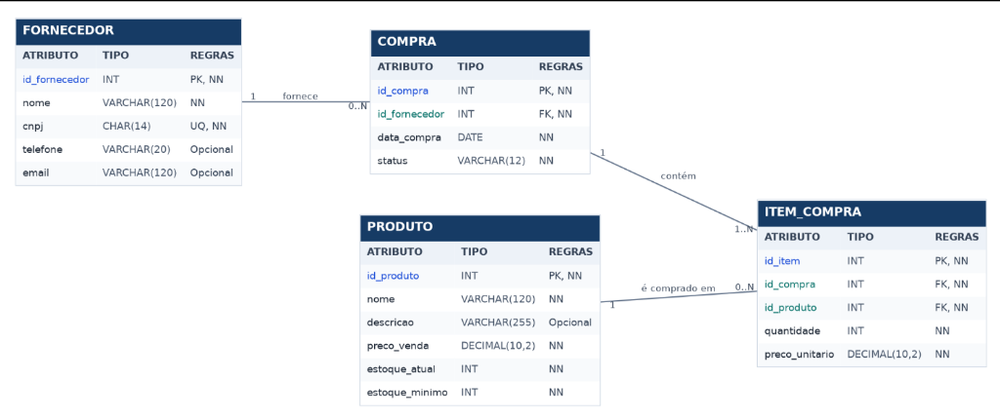

# Sistema de Gerenciamento de Estoque (MongoDB)

Trabalho desenvolvido para a disciplina de **Banco de Dados (2026/2)** do professor **Howard Roatti**.

O projeto consiste em um sistema em terminal feito em **Python** integrado ao banco de dados não relacional **MongoDB** (reutilizando e migrando a estrutura do trabalho anterior em Oracle), gerenciando as coleções `fornecedor`, `produto`, `compra` e `item_compra`.

## Integrantes

- Arthur Gava Calil
- André Luiz Alves Bofonha
- Miguel Gomes
- Kawan Wendler Goldner
- João Vitor Gnocchi da Cunha
- João Vitor Gera Bof

## Vídeo de Demonstração

Link do YouTube: [inserir link do vídeo aqui]

## Diagrama Relacional



## Passo a Passo para Rodar no Linux (VM da Disciplina)

### 1. Iniciar os bancos na VM (MongoDB e Oracle)
Abra o terminal na VM e garanta que os serviços/containers do MongoDB (e do Oracle, para a migração inicial dos dados) estejam rodando:

```bash
docker start $(docker ps -aq)
```
*(Caso o MongoDB rode como serviço nativo na VM: `sudo systemctl start mongod`).*

### 2. Clonar o repositório e instalar as dependências
No terminal, baixe o projeto, ative o ambiente virtual e instale as bibliotecas (`pymongo`, `pandas` e `oracledb`):

```bash
git clone https://github.com/joaovitor0101/SistemaDeGerenciamentoDeEstoque-MongoDB-C3.git
cd SistemaDeGerenciamentoDeEstoque-MongoDB-C3

python3 -m venv .venv
source .venv/bin/activate
pip install -r requirements.txt
```

### 3. Criar as coleções no MongoDB e migrar os registros
Entre na pasta `src` e execute o script que conecta no Oracle, extrai os registros das tabelas da etapa anterior, cria as 4 coleções no MongoDB (`fornecedor`, `produto`, `compra` e `item_compra`) e insere os documentos:

```bash
cd src
python3 create_collections_and_data.py
```

### 4. Iniciar o programa
Ainda na pasta `src`, execute o arquivo principal:

```bash
python3 principal.py
```

## Funcionamento do Sistema

Ao iniciar, o programa mostra na tela os nomes do grupo e a contagem atual de documentos em cada coleção do MongoDB, junto com as opções do menu:

- **1 - Relatórios:** exibe os relatórios do sistema consultando o MongoDB com pipelines de agregação (`$group` para compras por fornecedor, `$lookup` para itens de compra, produtos com estoque baixo e listagens individuais de fornecedores, produtos e compras).
- **2 - Inserir Documentos:** cadastra novos documentos nas coleções.
- **3 - Remover Documentos:** apaga um documento pelo ID após confirmação (verificando se há documentos filhos vinculados em outras coleções).
- **4 - Atualizar Documentos:** altera os dados de um documento existente e mostra na tela o resultado atualizado.
- **5 - Sair:** fecha o sistema.
